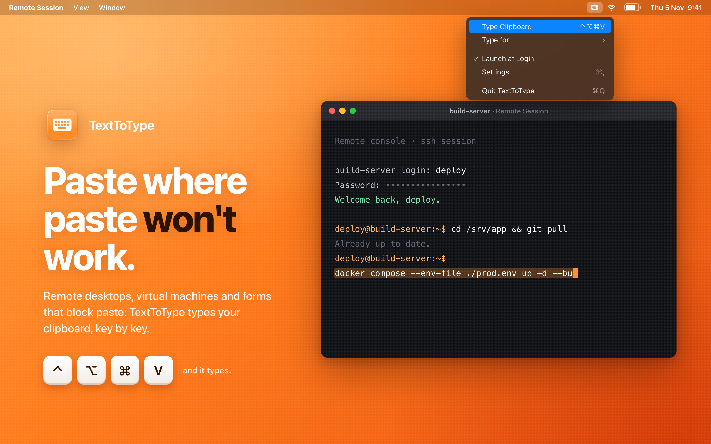

# TextToType

A tiny, free and open source macOS menu bar app that **types your clipboard** with real keystrokes, which is handy where paste doesn't work: remote desktops, VMs, VNC/Citrix sessions, server and installer consoles, and web forms that block paste.

- Global shortcut you can change (default **⌃⌥⌘V**). Press it again to stop typing.
- **Type for** (menu or Settings) picks how characters are sent:
  - **Any system (Unicode)**, the default, sends every character as text instead of key presses, so the keyboard layout doesn't matter. It works in Mac apps and in remote clients that pass text on; VMs, consoles and installer screens usually only understand key presses.
  - **Mac** presses your current keyboard layout's real keys (including ⇧/⌥ combinations). Characters that can't be reached with a single key fall back to Unicode input.
  - **Windows PC** presses keys for a Windows target over Remote Desktop or in a VM. Characters on the AltGr layer, like @ on a German keyboard (⌥L on a Mac, AltGr+Q on Windows), are then typed the Windows way. Built-in AltGr tables cover German, Austrian, Swiss, Spanish, Italian, Swedish, Finnish, Danish, Norwegian, French and UK layouts.
- Adjustable delay per key, for remote sessions that drop characters.
- Works with password managers: copy a password, press the shortcut. By default the clipboard is cleared afterwards when the password manager marked the text as a password (`org.nspasteboard.ConcealedType`), or always if you prefer.
- Lives in the menu bar and can launch at login.
- In English, German, French, Italian, Spanish and Portuguese (Brazil). It follows your Mac's language; to pick another, use **Settings → General → Language**.
- Sandboxed, with no network access and no data collection (see [PRIVACY.md](PRIVACY.md)).

## Usage

1. Copy some text.
2. Click into the window where it should be typed.
3. Press your shortcut (default ⌃⌥⌘V). Press it again to stop.

### With a password manager

Copy the password in KeePassXC, Bitwarden, 1Password etc., then press the shortcut. TextToType reads the clipboard once when typing starts, so the password manager's clipboard timeout doesn't cut typing short, even with a long delay per key.

Under **Settings → Typing → Clear clipboard after typing** choose:

- **Only passwords** (default): clears the clipboard if the password manager marked the text as concealed. Not every password manager does this; if yours doesn't, use **Always**.
- **Always**: clears the clipboard after every completed typing run.
- **Never**: leaves the clipboard untouched.

The clipboard is never cleared if you copied something else while typing, or if you stopped typing early.

## Build

Requirements: macOS 14+, Xcode 26+ (the app icon is an Icon Composer `.icon` file).

Open `TextToType.xcodeproj` in Xcode and press Run. The project is generated from `project.yml` with [XcodeGen](https://github.com/yonaskolb/XcodeGen); after editing `project.yml`, run `xcodegen generate`.

To build it yourself, change `DEVELOPMENT_TEAM` and `PRODUCT_BUNDLE_IDENTIFIER` in `project.yml` (or under *Signing & Capabilities* in Xcode) to your own.

## Permissions

Typing needs **Accessibility** access: System Settings → Privacy & Security → Accessibility → enable TextToType.

> macOS ties the Accessibility grant to the app's signature. Debug builds (Apple Development) and release builds count as different apps. If the switch is on but typing doesn't work, remove TextToType from the list with − and add the copy you're running again.

For launch at login, put the app in `/Applications` first, then turn on **Launch at login** from the menu or Settings.

## Project layout

| Path | Contents |
| --- | --- |
| `TextToType/` | App source (SwiftUI + AppKit) |
| `TextToType/Typer.swift` | Posts the keyboard events |
| `TextToType/KeyboardLayout.swift` | Maps characters to keys on the current layout |
| `TextToType/HotKeyManager.swift` | Global shortcut (Carbon `RegisterEventHotKey`) |
| `AppStore/` | App Store metadata, screenshots and their HTML sources |

## Contributing

Issues and pull requests are welcome: https://github.com/akandor/TextToType/issues

## License

[MIT](LICENSE) © 2026 Armin Toepper

Keyboard icon from [Font Awesome Free](https://fontawesome.com) ([CC BY 4.0](https://fontawesome.com/license/free)).
